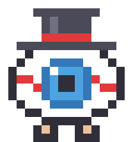
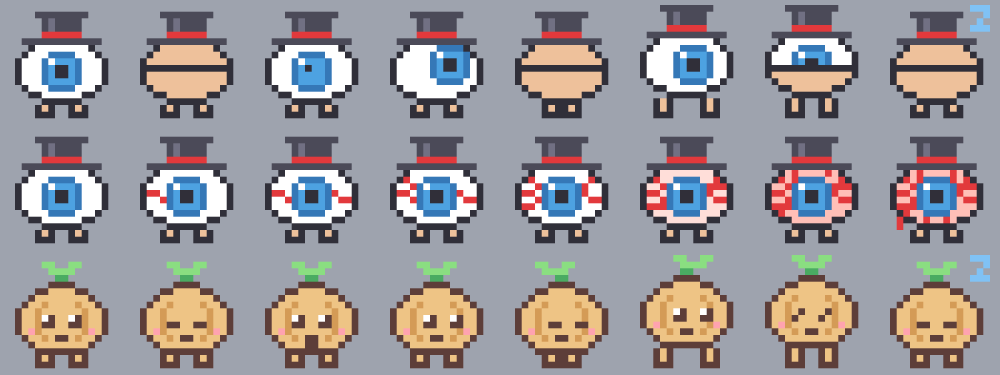

<p align="center">
  
</p>

<h1 align="center">myoko</h1>

<p align="center">
  <i>a tiny eyeball in a top hat who lives next to your notch<br>and gets very, very bloodshot if you don't take breaks.</i>
</p>

---

hi, i'm myoko 👁️🎩

my name is *my oko*: "my eye". *oko* is old russian for "eye", and i am very much yours. i sit in your menu bar and watch you work. the longer you stare at your screen, the redder i get. when it's time for a break, i come and get you.

- 👀 **every 20 minutes:** look at something far away (6 m or more) for 20 seconds
- 🚶 **every hour:** go for a little walk. i hold the screen for 2 minutes so you actually go
- 🧅 **not into eyeballs?** pick the onion from the menu. it's much calmer than me



## 🛠️ adopt a myoko

you need macOS 13 or newer and the Xcode command line tools.

```bash
git clone https://github.com/termvato/myoko.git
cd myoko
./build.sh
open Myoko.app
```

i'll appear next to the notch. to move me, hold ⌘ and drag.

i'm ad-hoc signed, so i only run on the Mac that built me. to hand out a ready-made app, you'd need to sign and notarize me with an Apple Developer ID.

## 🫣 how i get you

i don't just pop up. i warn you first:

1. **i peek** up from the bottom of your screen, with a countdown at the top
2. **i grow**, slowly, while you finish your sentence. you can still click and type
3. **i stomp.** after 10 seconds i'm full size and the screen is mine until the break is done

## 🚪 escape hatches

i'm needy, not a hostage-taker. there's always a way out:

- hold **Esc** for 3 seconds to skip the break
- click **later** to snooze me (5 min for eyes, 10 min for walks)
- if anything goes wrong, a watchdog closes me 10 seconds after the break should have ended
- Force Quit always works

too much? untick **take over the screen** in my menu and i'll just send a little popup instead.

## 🤝 my manners

- **on a call?** if a mic or camera is in use, i send a polite popup instead of stomping on your meeting. i only check whether a device is running, so i never turn one on or ask for permission
- **stepped away?** after 5 minutes with no input, or when your Mac wakes up, i reset. you already had your break
- **watching videos?** a playing video still counts as screen time, even though you're not touching anything. calls and screen sharing count the same way
- **privacy:** no network, no analytics, no accounts. i only watch *you*, and only metaphorically

## ⏱️ changing my schedule

my timings live at the top of [`Sources/main.swift`](Sources/main.swift). change a number and rerun `./build.sh`.

to see me in action without waiting 20 minutes:

```bash
MYOKO_EYE_SECONDS=3 Myoko.app/Contents/MacOS/Myoko --eye-now
```

`--walk-now` does the same for a walk, and keeps the screen for the full 2 minutes unless you bail.

## 🔬 does this actually help?

a bit, honestly. the evidence is modest:

- **eye breaks:** in a study of 29 people with eye strain, 20-20-20 reminders reduced eye strain and dry eye symptoms, but the benefit was gone a week after the reminders stopped. it had no control group, and nobody has really shown the exact numbers matter. ([Talens-Estarelles et al.](https://research.aston.ac.uk/en/publications/the-effects-of-breaks-on-digital-eye-strain-dry-eye-and-binocular/))
- **walking breaks:** a meta-analysis of short lab trials found light walking breaks lower blood sugar after meals better than standing breaks. ([Buffey et al., 2022](https://link.springer.com/article/10.1007/s40279-022-01649-4))
- **how often:** in a small trial of 11 adults, only 5 minutes every 30 minutes significantly reduced the blood sugar rise, but every schedule, hourly included, lowered blood pressure. ([Duran et al., 2023](https://sedentarybehaviour.org/2023/05/31/breaking-up-prolonged-sitting-to-improve-cardiometabolic-risk-dose-response-analysis-of-a-randomized-crossover-trial))

so i won't fix your eyes. i'll just make you look away from me every now and then, which is a little ironic.

## 📜 license

[MIT](LICENSE). take me home, change my hat.
